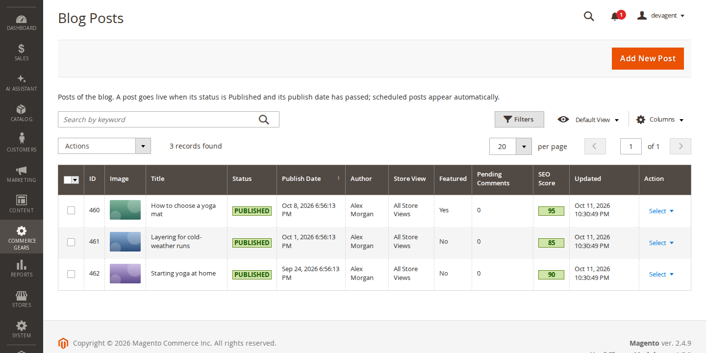
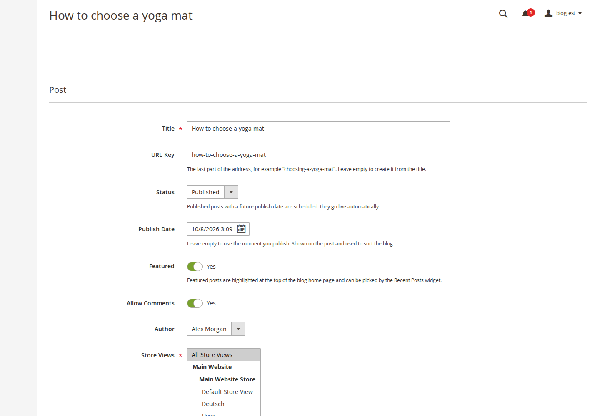
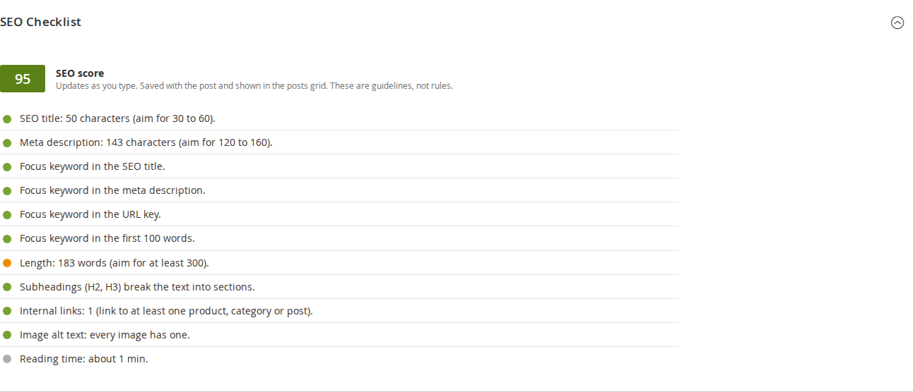
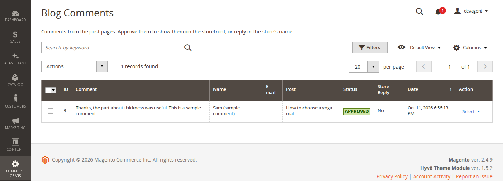
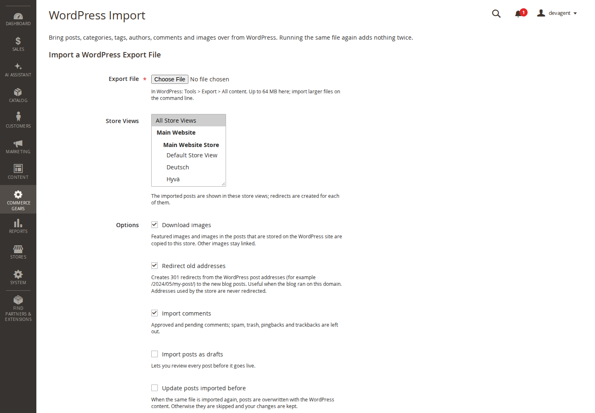

# Softaware Blog for Magento 2: User Guide

Softaware Blog adds a blog to your Magento store: posts, categories, tags, author pages and comments, with the SEO
details search engines look for, a per-post SEO checklist, widgets for CMS pages and an import from WordPress. It has
templates for Luma and for Hyvä.

## Requirements

| | |
|---|---|
| Magento | Magento Open Source or Adobe Commerce 2.4.7 to 2.4.9 |
| PHP | 8.2, 8.3, 8.4 or 8.5 (with the curl, dom and xmlreader extensions) |
| Themes | Luma (and themes based on it) and Hyvä |
| Other | `softaware/module-core` 1.3 or later (installed automatically), Magento cron for scheduled posts and imports |

## Installation

Softaware modules are installed with Composer from repo.softawarecommerce.com. Set up access once as described on
https://softawarecommerce.com/shop/composer-access/, then:

```
composer require softaware/module-blog
bin/magento module:enable Softaware_Core Softaware_Blog
bin/magento setup:upgrade
bin/magento setup:di:compile            # production mode only
bin/magento setup:static-content:deploy # production mode only
bin/magento cache:flush
```

On Hyvä, rebuild the theme CSS afterwards (`npm run build` in your theme's `web/tailwind` folder) so the blog's
Tailwind classes are included. The module registers itself for Hyvä's Tailwind configuration.

To see the blog straight away, add the sample content:

```
bin/magento softaware:blog:sample-data
```

This creates three posts, two categories, four tags, one author and a comment, all clearly marked as samples. Remove
them again with `bin/magento softaware:blog:sample-data --remove`.

## Configuration

Stores > Configuration > Softaware > Blog. Every setting can be set per website or store view.

**General**

- Enabled: switches the storefront pages, widgets, feed and sitemap entries on or off.
- Blog Title: heading of the blog home page, breadcrumb and menu link.
- Blog URL Path: address of the blog home page, for example `blog` for /blog or `company/news` for /company/news.
  It cannot start with an address Magento or an extension already uses (for example `checkout` or `customer`).
  Changing it does not redirect the old blog addresses; add redirects in Marketing > SEO & Search > URL Rewrites.
- URL Suffix: none (/blog/my-post), `.html` or a slash. Old addresses redirect (301) to the new form when you change it.
- Category, Tag and Author URL Prefix: the part between the blog path and the name, for example /blog/category/running.
- Link in the Main Menu: adds the blog title as the last item of the category menu (Luma and Hyvä).
- Link in the Footer (Luma): adds the blog to the footer links of Luma-based themes.

**Post Lists**: posts per page, excerpt length, and whether featured posts are shown at the top of the blog home page
(and how many).

**Post Page**: show the author, reading time (with the reading speed), share links, previous and next post, the number
of related posts and related products, and the heading above the related products.

**Sidebar**: the blog sidebar with categories, recent posts and tags (each can be turned off by setting it to 0 or No).

**Product Pages**: shows posts that feature the product on its product page ("From our blog"), with the number of
posts and the heading.

**Search Engines and Sharing**: meta title, description and keywords of the blog home page; a suffix added to every
blog meta title; default robots for posts, categories, tag pages, author pages and for page 2 and later of a list;
Open Graph and Twitter Card tags; JSON-LD structured data with the publisher name; hreflang links between store views
with different languages.

**XML Sitemap**: adds the blog home page, categories and posts (optionally tag and author pages and featured images) to
the sitemap that Marketing > SEO & Search > Site Map generates, with priorities and change frequencies. Posts set to
NOINDEX or with a custom canonical URL are left out.

**RSS Feed**: the feed at /blog/rss.xml (and /blog/rss.xml?category=<url-key> for a category), the number of posts and
whether the full content is included.

**Comments**: comments on or off, whether guests may comment, which comments are published without review (none,
signed-in customers, all), whether comments with links are always reviewed, minimum and maximum length, comments per IP
address per hour, an optional consent checkbox text, the name store replies are signed with, Google reCAPTCHA (uses
Magento's reCAPTCHA modules and the keys under Stores > Configuration > Security > Google reCAPTCHA Storefront) and the
e-mail to the store about new comments (recipient, sender and template).

## Writing posts

Softaware > Blog > Posts lists the posts with their image, status (Draft, Scheduled, Published), publish date, author,
store views, pending comments and SEO score. Filter by store view or category, search by title, and publish, set to
draft or delete several posts at once.



Add New Post opens the editor:

- **Post**: title, URL key (created from the title when empty), status, publish date, featured, comments allowed,
  author, store views, categories and tags. Tags are typed as a comma-separated list; new tags are created on save.
  A published post with a future publish date is scheduled and goes live by itself at that time.
- **Content**: featured image (upload or pick from the media gallery) with its alt text, excerpt for lists, and the
  content in Magento's editor, with images, widgets and variables.
- **SEO Checklist**: checks the post as you type and gives a score from 0 to 100 (see below).
- **Search Engine Optimisation**: focus keyword, meta title, meta description, meta keywords, robots and a custom
  canonical URL (only for posts that copy a page elsewhere).
- **Related Products**: Add Related Products opens a product grid; pick products and drag the rows into order. The
  products are shown below the post, and the post appears in the "From our blog" block of these product pages.



Preview opens a draft or scheduled post on the storefront through a signed link that works for 24 hours; for live
posts the button is called View.

### Store view content

Use the scope switcher at the top of the editor to change the title, URL key, excerpt, content, image alt text and meta
data of a post for one store view. Untick "Use Default Value" next to a field to give it its own value. Status, dates,
categories, tags, author and images are the same for every store view. Categories and tags work the same way.

### SEO checklist



The checklist looks at the SEO title (30 to 60 characters), the meta description (120 to 160 characters), whether the
focus keyword appears in the title, the meta description, the URL key and the first 100 words, the length (at least 300
words), headings (H2 and H3 in the content, no H1), internal links, and alt texts of the featured image and the images
in the content. It also shows the reading time. The score is saved with the post. The checks are guidelines; a post
can be published whatever its score.

## Categories, tags and authors

- **Categories** can be nested; the grid shows them as a tree. Inactive categories and their subcategories are hidden
  on the storefront. Each category has a description, meta data and a robots setting.
- **Tags** have their own page with their posts, an optional description and meta data. Tag pages are NOINDEX by
  default because they often repeat category pages.
- **Authors** have a name, URL key, job title, photo, a plain text biography, website, LinkedIn and X addresses and
  meta data. The author's name links to the author page with the biography and the author's posts.

## Comments

Comments appear under the post once approved. Softaware > Blog > Comments lists them with their status; approve,
reject, set back to pending or delete several at once. Open a comment to correct its text, change its status or reply:
the reply is published under the comment in the store's name.



The comment form has a hidden honeypot field and a limit of comments per IP address per hour (IP addresses are stored as
a hash only). With reCAPTCHA chosen in the settings, Magento's reCAPTCHA is shown on the form. Comments are sent without
a page reload, so the post page stays in the full page cache.

## Widgets

Content > Widgets (or Insert Widget in any editor) offers three widgets for CMS pages and blocks:

- Softaware Blog: Recent Posts: latest posts, optionally of one category (including its subcategories) or featured
  posts only, with or without image and excerpt.
- Softaware Blog: Categories: links to the blog categories, optionally limited to a number of levels.
- Softaware Blog: Tags: the most used tags.

## Importing from WordPress

1. In WordPress, go to Tools > Export, choose All content and download the file.
2. In Magento, go to Softaware > Blog > WordPress Import, choose the file, the store views and the options, and click
   Upload and Import.



The import runs in the background with cron, usually starting within a minute. Large files are imported in steps of
about 50 seconds, each continuing where the previous one stopped; the grid shows the progress, and View Log shows the
details. Larger files than the upload limit can be imported on the command line:

```
bin/magento softaware:blog:import-wordpress /path/to/export.xml
```

What is imported:

- Posts (published, scheduled and drafts; password-protected and private posts become drafts), with excerpt, publish
  date, sticky posts as featured posts, and comments switched off where they were closed.
- Categories with their parents, tags and authors. WordPress' "Uncategorized" category is left out. Existing categories,
  tags and authors with the same URL key or name are used instead of creating duplicates.
- Meta title, meta description, focus keyword and noindex from Yoast SEO, Rank Math or All in One SEO (titles made of
  template variables are skipped).
- Approved and pending comments with their replies; spam, trash, pingbacks and trackbacks are left out.
- Images: the featured image and the images in the posts that are stored on the WordPress site (or its subdomains and
  WordPress.com's image service) are downloaded to pub/media/softaware_blog/ and the posts point to the copies.
- Redirects: 301 redirects from the old post addresses to the new ones, as custom URL rewrites in Marketing > SEO &
  Search > URL Rewrites. An address that the store already uses, or that starts with one of the store's own routes
  (for example /checkout/ or /customer/), is never redirected.

Options: download images, redirect old addresses, import comments, import all posts as drafts, and update posts that
were imported before. Every record remembers its WordPress ID, so running the same file again creates nothing twice:
posts imported before are skipped (or updated when you choose so), comments and redirects are added only once.

Image downloads are protected: only http and https on the standard ports, no addresses that resolve to private or
internal networks, at most three redirects, 20 seconds and 10 MB per image, and the file must be a JPEG, PNG, GIF or
WebP image.

Text in the WordPress content that looks like a Magento directive (`{{...}}`, for example in code samples) is kept as
text and is not run as a directive.

## Command line

```
bin/magento softaware:blog:import-wordpress <file> [--store=1,2] [--no-images] [--no-redirects] [--no-comments] [--drafts] [--update] [--queue]
bin/magento softaware:blog:import-wordpress --job=<id>
bin/magento softaware:blog:publish-scheduled
bin/magento softaware:blog:sample-data [--remove]
```

`--queue` only adds the job for cron; `--job` runs a job from the admin (also a failed one, which continues where it
stopped). `publish-scheduled` refreshes the cached pages of scheduled posts whose time has come; cron does this every
five minutes.

## Permissions

System > Permissions > User Roles > Role Resources, under Softaware > Blog: Posts (with Create and Edit, Publish and
Delete), Categories, Tags, Authors, Comments (with Moderate and Reply, and Delete) and WordPress Import. The settings are
under Stores > Settings > Configuration > Softaware Blog. Editors without Publish can write new posts (saved as drafts)
and edit existing ones, but cannot change their status or publish date.

## Troubleshooting

- **The blog shows a 404 page**: check that the blog is enabled for the store view and that the blog URL path does not
  clash with a CMS page or category with the same address.
- **An import stays queued**: Magento cron is not running. Run `bin/magento cron:run`, or import on the command line
  with `bin/magento softaware:blog:import-wordpress --job=<id>`.
- **Images were not imported**: View Log lists each image that failed and why (for example a 404 on the old site or an
  image larger than 10 MB). Images on other domains are not downloaded.
- **A scheduled post did not appear**: cron refreshes the cached pages every five minutes; run
  `bin/magento softaware:blog:publish-scheduled` to do it now.
- **Hyvä styles look unstyled**: rebuild the Hyvä theme CSS so the blog's Tailwind classes are included.

## Uninstall

```
bin/magento module:disable Softaware_Blog
composer remove softaware/module-blog
bin/magento setup:upgrade
```

The blog tables (`softaware_blog_*`) and the images in pub/media/softaware_blog/ are kept; delete them if you no longer
need the content. Redirects created by the WordPress import are ordinary URL rewrites and can be removed in Marketing >
SEO & Search > URL Rewrites.
